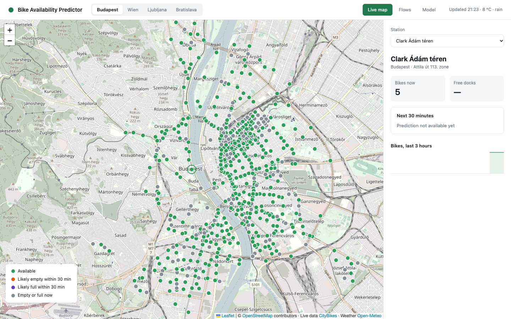
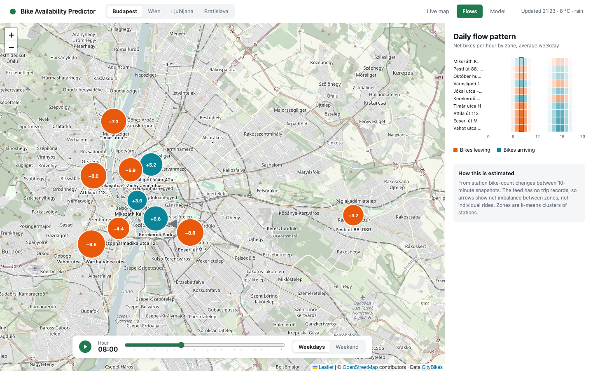
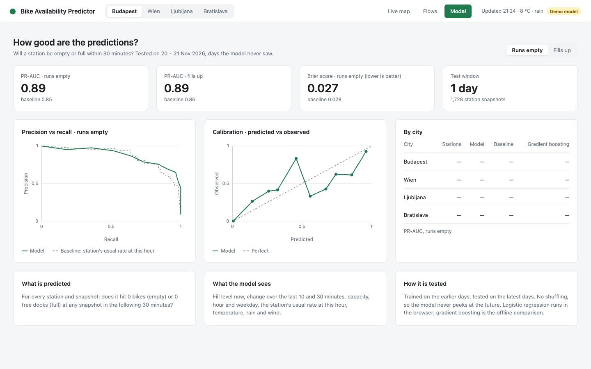

# Bike Availability Predictor

A web page that shows, for every station of four Central European bike-sharing systems (Budapest MOL Bubi,
WienMobil Rad, Ljubljana BicikeLJ and Bratislava Slovnaft BAJK), the probability that the station runs out of bikes
or fills up within the next 30 minutes. A GitHub Actions job saves a snapshot of every station every 10 minutes. A
nightly job trains a logistic regression on those snapshots, and the browser evaluates the model on live data. The
page also shows the daily pattern of net bike flows between parts of each city and how good the predictions are on
days the model never saw.

- Live site: https://agaszner.github.io/Bike_Sharing_Availability_Predictor/
- Figma design (the three screens, made before any code): https://www.figma.com/design/ER3Fejs1NlqKROBYtXBIzX

## Screenshots

**Live map**



*Taken on 2026-11-12, before a model could be trained. Because no model exists yet, the markers are only green
(available) and grey (empty or full now), and the panel says "Prediction not available yet".*

**Flows**



*Shown with synthetic demo data; real numbers appear once the nightly training has enough data. The zones are the real
Budapest zones, but the net flows and arrows were made up for the screenshot.*

**Model**



*Shown with synthetic demo data (`?demo=1`); real numbers appear once the nightly training has enough data.*

## How to use it

The bar at the top switches the city (Budapest, Wien, Ljubljana, Bratislava) and the view (Live map, Flows,
Model). The URL keeps both, for example `#wienmobil-rad/flows`, so a view can be bookmarked.

### Live map

Every station is a dot. The page reloads live counts every minute. The colour is the model's verdict for the next
30 minutes:

| Colour | Meaning |
|---|---|
| Green | Available: neither probability reaches 50 %, or there is no prediction and the station has bikes |
| Orange | Likely empty within 30 min: the probability of running out of bikes is at least 50 % and the higher one |
| Purple | Likely full within 30 min: the probability of no free dock is at least 50 % and the higher one |
| Grey | Empty or full now: the station has 0 bikes, or it is a docked station with 0 free docks; it is not scored |

Hovering a dot shows its name, bike count and state. Clicking a dot, or choosing a station in the **Station**
picker above the panel (which also works from the keyboard), opens the panel on the right:

- bikes now and free docks (a dash when the station has no real docks);
- "Next 30 minutes": the probability that the station runs out of bikes and, for docked stations, that it fills up;
- a sparkline of the bike count over the last 3 hours;
- "Most at risk in &lt;city&gt;": the four stations with the highest predicted probability; clicking one selects it.

### Flows

The city is divided into zones (circles). For the selected hour, a circle shows the average net change of bikes in
that zone: orange when more bikes leave than arrive, teal when more arrive, and its size grows with the amount.
Arrows connect zones that lose bikes to nearby zones that gain them. The **hour slider** picks the hour, **play**
steps through the day automatically, and **Weekdays / Weekend** switches between the average weekday and the average
weekend day. The heatmap on the right shows all zones and all 24 hours at once, with the selected hour outlined.

### Model

The Model view reports the test results of the current model: PR-AUC for "runs empty" and "fills up", each next to
the baseline, the Brier score with its baseline, and the length of the test window. Below are a precision-recall
curve, a calibration plot and a per-city PR-AUC table that also shows gradient boosting. The **Runs empty / Fills up**
switch changes the target. Until the first successful training the view says that the model has not been trained.

### Demo switch

Adding `?demo=1` to the address (for example
`https://agaszner.github.io/Bike_Sharing_Availability_Predictor/?demo=1`) replaces the real model and profiles with
the synthetic model from `web/predict.fixture.json`. A "Demo model" badge appears in the top bar. I use it to show
the Model view and coloured markers before enough real data exists. The demo numbers come from made-up data and say
nothing about real stations. Flows are not affected by the switch.

## Run it locally

Serve the site (the Live map needs internet access for the live APIs):

```sh
python3 -m http.server -d web 8765
# open http://localhost:8765/
```

Set up Python (3.12 is what CI uses) and install the dependencies:

```sh
python3 -m venv .venv
.venv/bin/pip install -r requirements.txt
```

Fetch the collected data. The snapshots live on the orphan `data` branch; this checks it out into `data/`, which is
git-ignored on `main`:

```sh
git fetch origin data && git worktree add data origin/data
# later, to update it: git fetch origin data && git -C data checkout -q --detach origin/data
```

Retrain. This overwrites `web/model.json`, `web/profiles.json`, `web/flows.json` and `web/fixtures.json`:

```sh
.venv/bin/python -m model.train data web
```

Run the tests (Python: collector and model; JavaScript: the browser code, with Node 24):

```sh
.venv/bin/python -m pytest -q -W error      # OMP_NUM_THREADS=1 in front makes it several times faster
node --test 'web/*.test.js'
```

Regenerate the browser parity fixture after changing the feature code:

```sh
.venv/bin/python -m model.make_js_fixture
```

### Automation on GitHub

| Workflow | When | What it does |
|---|---|---|
| `.github/workflows/collect.yml` | every 10 minutes (`3-59/10 * * * *`) and by hand | saves one snapshot of all four networks to the `data` branch |
| `.github/workflows/train.yml` | daily at 02:17 UTC and by hand | runs the Python tests, trains, runs the JavaScript tests, and, if the four JSON files changed in more than `trained_at`, commits them to `main` and starts `pages.yml` |
| `.github/workflows/pages.yml` | on a push to `main` that touches `web/**`, and by hand | publishes `web/` to GitHub Pages |

GitHub's scheduled runs are best-effort: they start late, are sometimes dropped (most often at minute 0, which is
why the schedules avoid it), and in the first hours of this repository none fired at all. So the spacing between
snapshots is irregular, and a run can be started by hand at any time:

```sh
gh workflow run collect.yml
gh workflow run train.yml
gh workflow run pages.yml      # e.g. for the first deployment
```

Pages must be set once to Settings → Pages → Source: GitHub Actions. A push made by a workflow with the default
`GITHUB_TOKEN` does not trigger other workflows, so `train.yml` starts `pages.yml` itself. If the data is still too
thin to train, `train.yml` writes "not trained yet" files and stays green.

## How it works

### Pipeline

```
collect.yml (GitHub Actions, every 10 min)
   │  CityBikes API: bikes and free docks per station
   │  Open-Meteo: current temperature, precipitation, wind per city
   ▼
data branch: snapshots/YYYY-MM-DD/HHMM.csv, weather.csv, stations/<network>.json,
             latest/<network>.json (last 18 snapshots, about 3 hours)
   │
   ▼
train.yml (nightly): python -m model.train data web
   │
   ▼
web/model.json (scaler + coefficients + metrics), web/profiles.json, web/flows.json, web/fixtures.json
   │  committed to main, deployed by pages.yml to GitHub Pages
   ▼
browser: live counts (CityBikes) + live weather (Open-Meteo) + recent history (latest/ from the data branch)
         → the same 13 features → logistic regression → probability per station
```

There is no server: per target, the model is 13 coefficients, an intercept and the scaler's means and standard
deviations, and the browser computes the prediction itself (`web/predict.js`).

### Label

For a station at snapshot time *t*, `empty_30` is 1 if the station has 0 bikes at any snapshot in (*t*, *t* + 30 min],
otherwise 0. `full_30` is the same with 0 free docks. If that window contains fewer than 2 snapshots of the station,
the row has no label and is not used; `full_30` also has no label if any free-dock value in the window is missing.
(`model/features.py`, `add_labels`.)

### Features

The model sees 13 numbers per station and moment (`FEATURES` in `model/features.py`, mirrored in `web/predict.js`):

1. `bikes`: bikes at the station now.
2. `slots`: free docks now (0 when the feed gives none).
3. `cap`: the station's capacity, the largest bikes + free docks seen in the station's profile data (at least 1); for
   a station without a profile, bikes + free docks now.
4. `fill`: `bikes / cap`, clipped to 0–1.
5. `d10`: bikes now minus bikes at the snapshot closest to 10 minutes old, among snapshots 5–20 minutes old; 0 if
   there is none.
6. `d30`: the same for the snapshot closest to 30 minutes old, among snapshots more than 20 and at most 45 minutes
   old.
7. `hour_sin` and 8. `hour_cos`: the local (Europe/Budapest) time of day as a fractional hour, on a circle so that
   23:59 and 00:00 are close.
9. `is_weekend`: 1 on Saturday and Sunday (local time).
10. `base`: the station's usual rate of this outcome at this local hour (see Baseline).
11. `temp`, 12. `precip`, 13. `wind`: temperature, precipitation and wind speed from Open-Meteo. In training, the
    latest reading for the city at or before *t*, if it is at most 60 minutes old, otherwise the median of all
    readings. In the browser, the current reading; if the weather request fails, the model's mean for that feature.

### Only "transition" rows

The "runs empty" model is trained and evaluated only on rows where the station has at least one bike now. The
"fills up" model uses only rows of docked stations with at least one free dock now. A station that is already
empty or full is shown grey and not scored. The question the model answers is therefore "will this station *become*
empty or full", not "is it still empty", which keeps the metric honest. A station that is empty now is very likely
to be empty in 10 minutes too, and counting those easy cases would inflate the score.

A station counts as docked if the feed does not flag it as virtual and it never reported a missing free-dock count in
its profile data.

### Training and test split

Rows are split by time, not at random. The cut is at 80 % of the time span between the first and the last snapshot:
earlier rows train, rows from the cut onwards test. A training row's label looks 30 minutes ahead, so training rows
from the last 30 minutes before the cut are dropped (the purge gap); otherwise their labels would contain test-period
snapshots. The station profiles (capacity, docked or not, and the hourly rates used as the `base` feature) come from
the training rows only during training and evaluation. For the browser, `web/profiles.json` is rebuilt from all
collected data, while the coefficients stay the ones fitted on the training rows. (`model/train.py`, `time_split`
and `run`.)

One model per target is trained on the rows of all four cities together. A target is trained only if the training
rows contain at least 50 positive labels and at least one negative label; otherwise the files say "not trained".

### Baseline

The baseline is the station's usual rate at that hour: the share of training rows of that station and local hour
whose label was positive, counted only over rows eligible for the target (at least one bike now for "empty"; a
docked station with a free dock for "full"). Missing station-hours fall back to the city's rate at that hour, then
to the city's overall rate, then to 0. Because it uses only training data, it is a fair comparison on the test
rows. (`build_profiles` in `model/features.py`.)

### Metrics

All metrics are computed on the test rows, for each target. The scalar metrics (PR-AUC and Brier score) are
computed overall and per city; the precision-recall curves and the calibration plot use the overall test rows only:

- **PR-AUC**, computed as average precision (`sklearn.metrics.average_precision_score`), for the logistic regression,
  the baseline and gradient boosting.
- **Brier score**: the mean squared difference between the predicted probability and the 0/1 outcome, for the
  logistic regression and the baseline. Lower is better.
- **Calibration**: the predicted probabilities are split into ten bins of width 0.1, and for each bin the mean
  predicted probability is plotted against the observed rate of positives.

### Logistic regression vs gradient boosting

The deployed model is a `StandardScaler` + `LogisticRegression` pipeline. Its scaler means, standard deviations,
coefficients and intercept are exported to `web/model.json`, which is all the browser needs. A
`HistGradientBoostingClassifier` is trained on the same rows only as an offline comparison; its PR-AUC appears in the
Model view, but it is not deployed, because a tree ensemble cannot be evaluated in the browser without much more code.

### Browser/Python parity

The features are computed twice: in Python for training and in JavaScript for live use. Three checks keep the
browser in line with Python:

- `python -m model.make_js_fixture` trains on the synthetic data of `model/test_train.py` and writes
  `web/predict.fixture.json`. That file has raw browser inputs (counts, history, time, weather) together with the
  features and probability Python computes for them. `web/predict.test.js` requires the JavaScript features to match
  within 1e-9 and the probabilities within 1e-6.
- `model/test_make_js_fixture.py` regenerates the fixture and fails if the committed file is stale.
- Every training run writes `web/fixtures.json` (up to 20 test rows per trained target: the feature vectors Python
  computed and their Python probabilities), and `predict.test.js` applies `predict` with the real `model.json` to
  those feature vectors. This verifies the exported scaler and coefficients, not the JavaScript feature code (the
  first check covers that). In `train.yml` this runs after training and before the commit, so a mismatch blocks the
  deployment.

### Zones and net flows

`model/flows.py` groups each city's stations into zones with k-means on latitude and longitude:
k = min(max(2, round(5% of stations)), distinct locations), so one zone per about 20 stations. Each zone is named after the station nearest its centre.
For every station, it takes the change in bike count between consecutive snapshots at most 20 minutes apart and
assigns it to the local hour of the later snapshot. These changes are summed per zone, day and hour, then averaged
over the days on which that zone and hour had data, separately for weekdays and weekend days. The arrows are
matched greedily: zones losing bikes are paired with zones gaining bikes, nearest pairs first, keeping at most 8
arrows of at least 1 bike per hour.

## Results

Data collection began on 2026-11-12, so no real results exist yet.
Numbers: to be filled after the final training run on 2026-12-03.
They will come from `web/model.json`, the same numbers the Model view shows.

Overall (test window: to be filled)

| Target | PR-AUC model | PR-AUC baseline | PR-AUC gradient boosting | Brier model | Brier baseline |
|---|---|---|---|---|---|
| Runs empty | to be filled | to be filled | to be filled | to be filled | to be filled |
| Fills up | to be filled | to be filled | to be filled | to be filled | to be filled |

By city, PR-AUC

| City | Target | Stations | Model | Baseline | Gradient boosting |
|---|---|---|---|---|---|
| Budapest | Runs empty | to be filled | to be filled | to be filled | to be filled |
| Wien | Runs empty | to be filled | to be filled | to be filled | to be filled |
| Ljubljana | Runs empty | to be filled | to be filled | to be filled | to be filled |
| Bratislava | Runs empty | to be filled | to be filled | to be filled | to be filled |
| Budapest | Fills up | to be filled | to be filled | to be filled | to be filled |
| Wien | Fills up | to be filled | to be filled | to be filled | to be filled |
| Ljubljana | Fills up | to be filled | to be filled | to be filled | to be filled |
| Bratislava | Fills up | to be filled | to be filled | to be filled | to be filled |

## Limitations

- **Budapest gets "empty" predictions only.** The MOL Bubi feed flags every station as virtual, so no Budapest
  station counts as docked, and "fills up" is predicted only where docks are real (the other three cities).
- **Flows are net imbalance, not trips.** CityBikes has no trip records, so the flows come from bike-count changes
  between snapshots. They include bikes moved by rebalancing trucks, and two rides that cancel out are invisible.
- **Zones are not districts.** They are k-means clusters of station coordinates, named after the station nearest
  the centre, not administrative districts.
- **Irregular snapshots.** GitHub scheduled workflows are best-effort, so the spacing between snapshots is irregular
  and gaps occur. Labels need at least 2 snapshots in the 30-minute window, and the lag features use whichever
  snapshot is closest to 10 or 30 minutes old.
- **A few weeks of November data.** There is no seasonality: the model has not seen summer, holidays or snow.
- **Untuned threshold.** A station turns orange or purple at a probability of 0.5. The threshold was not tuned.
- **Third-party services.** The live page depends on CityBikes, Open-Meteo, raw.githubusercontent.com (for the recent
  history), the OpenStreetMap tile server and unpkg.com (which serves Leaflet; without it no map renders). If
  CityBikes fails, the page says that live data is unavailable.

## Experiences and lessons learned

### Tools and agents

- **Claude Code (CLI)** was the coding agent.
- **Claude Opus** ran both the main session and every subagent.
- **The superpowers plugin** for Claude Code supplied the workflow:
  - `brainstorming` turned the assignment into a design.
  - `writing-plans` turned the design into a plan of 8 tasks
    ([docs/superpowers/plans/2026-11-12-bike-availability-predictor.md](docs/superpowers/plans/2026-11-12-bike-availability-predictor.md)).
  - `subagent-driven-development` executed the plan. Each task had one implementer subagent and one reviewer
    subagent, and the implementer worked test-first. After the last task, a final reviewer checked the whole branch.
- **The Figma MCP server** created the three screen designs (Live map, Flows, Model) before any code was written:
  https://www.figma.com/design/ER3Fejs1NlqKROBYtXBIzX
- **GitHub Actions** runs the collector, the nightly training and the deployment. Claude Code wrote these
  workflows.
- **cron-job.org** is a free external scheduler that starts the collector. I added it by hand (see below).

### Key prompts

```text
Project: assignment 23, bike-sharing availability predictor. Live station map of MOL Bubi (Budapest) and three
other European cities; predict "station will be empty or full within 30 minutes"; show the daily flow patterns
between parts of each city. 

Workflow:
- Use superpowers: brainstorm with me, then write a plan of small tasks, then execute it subagent-driven on Opus,
  one implementer and one reviewer per task, test-first. Review each task against the plan and question the plan
  itself, not only compliance.
- Make the three screens (Live map, Flows, Model) in Figma before writing code.
- Keep it minimal: stdlib where possible, few dependencies, pinned versions.

Hosting and data (everything must be free):
- Static site on GitHub Pages. No backend: export the model as JSON and score it in the browser.
- Collector: GitHub Actions every 10 minutes, Python stdlib only. Save CityBikes snapshots for mol-bubi,
  wienmobil-rad, bicikelj and slovnaft-bajk, plus Open-Meteo weather, as CSV to an orphan `data` branch.
- GitHub cron is best-effort, so also trigger the collector from an external scheduler (cron-job.org calling
  workflow_dispatch). Tell me what I must set up by hand (Pages source, token), and check that runs arrive
  within the first hour.

Model:
- Labels: empty (0 bikes) or full (0 free docks) at any snapshot in the next 30 minutes. "Full" only for stations
  with real docks; check the feed for virtual stations.
- Train only on rows where the state can change. Features: bikes, slots, fill, change over the last 10 and 30
  minutes, hour of day, weekend, the station's historical rate for that hour, temperature, rain, wind.
- Logistic regression deployed; gradient boosting only as an offline comparison; the historical rate as baseline.
- Time-based train/test split with a 30-minute purge gap. Report PR-AUC and Brier score per city, a
  precision-recall curve and a calibration plot.
- A Python-generated fixture that the JavaScript scoring must reproduce exactly.
- Retrain nightly in GitHub Actions and redeploy only if the model changed.

Web:
- Leaflet + OpenStreetMap. Live map with risk colours, station details and a keyboard-accessible station picker.
  Stations without a prediction must look "unknown", never "available".
- Flows: k-means zones with about one zone per 20 stations (5%), named after the station nearest the centre;
  hourly net flow per zone, arrows between zones, an hour slider and a zone × hour heatmap. Say clearly that this
  is net imbalance, because CityBikes has no trip data.
- Model view with the metrics and the comparison to the baseline.
- A demo mode with clearly marked synthetic numbers until enough real data exists.
- README: usage, how it works, results, limitations, lessons learned.
```

### Hosting detour

My first plan was a Python backend on Hugging Face Spaces. Docker Spaces are no longer on the free tier. Render
was the next option, but it asks for a card. So the design moved to a static GitHub Pages site. The browser
evaluates the exported coefficients, and a nightly workflow retrains the model and commits the JSON files. This
also removed a server that would have had to stay awake.

### What the reviews caught

The reviewer subagents found these problems before they reached `main`. Each one has a `fix:` commit:

- The baseline rate was first computed over rows where the station was already empty, which inflated the
  baseline (`20a23eb`).
- An instruction in my own plan, to use train-period weather only, would have evaluated the model with weather
  effectively switched off. There was also no purge gap at the train/test cut (`5a756d3`).
- A station with no prediction could have been drawn as a green "available" marker (`c0780e1`).
- The browser parity fixture could go stale without any test failing (`c0780e1`).
- Station details were not reachable by keyboard (`d080186`, `457f1cd`).
- The final whole-branch review found data-robustness bugs. Stations missing from the station list were treated
  as docked (`58b66e8`). Rows without a bike count broke loading (`a28ec7b`). One failing cache file could drop a
  whole network from a snapshot (`6a659fd`).

### Lessons learned

- **A written plan with a review step per task was worth the overhead.** The most important bugs, a leaky
  baseline and weather switched off at evaluation, were logic errors. The tests passed with them.
- **The agent follows the plan even when the plan is wrong.** 
- **Check infrastructure early, not only code.** The code was correct, but the data collection silently ran at
  about 2% of the expected rate. A status question the next day found it. For a forecasting task, data is the
  bottleneck, so the collector should be verified within the first hour.
- **Free hosting constraints shape the architecture.** Choosing hosting first would have saved the backend
  detour.
- **Question the AI about the decisions that you did not make.**.
## Repository layout

| Path | Contents |
|---|---|
| `collector/` | `collect.py`, which saves one snapshot of all networks plus weather, and its tests |
| `model/` | loading the data branch, labels and features, training and evaluation, zones and flows, the parity fixture generator, and their tests |
| `web/` | the static site: `index.html`, `style.css`, the JavaScript modules and their tests, and the JSON written by training |
| `docs/` | the implementation plan (`docs/superpowers/plans/`) and the README screenshots |
| `.github/workflows/` | `collect.yml`, `train.yml`, `pages.yml` |
| `requirements.txt` | Python dependencies (pandas, numpy, scikit-learn, pytest) |
| `data` branch | the collected snapshots, weather and station lists (checked out into `data/` locally) |

## Data and attribution

- Station data: [CityBikes API](https://api.citybik.es/).
- Weather: [Open-Meteo](https://open-meteo.com/).
- Map data and tiles: © [OpenStreetMap contributors](https://www.openstreetmap.org/copyright).
- Map library: [Leaflet](https://leafletjs.com/).
